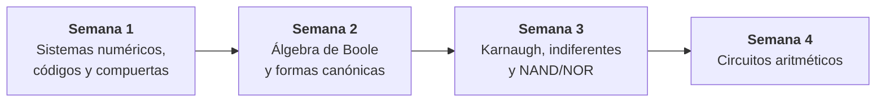

<div align="center">

# Cuaderno de Diseño de Circuitos

### Unidad 1 · Lógica combinacional con diseño clásico

**Universidad Nacional de Loja** · Carrera de Computación · 2.º ciclo, paralelo A

Período septiembre 2026 – marzo 2027


</div>

---

## Introducción

Este repositorio es el cuaderno de estudio de **Diseño de Circuitos**. Aquí se va ordenando, semana por semana, lo que se ve en clase, la teoría, los ejemplos resueltos, los talleres y apuntes adicionales que hice. La idea del cuaderno es que sirva de apoyo para repasar antes de una evaluación y para ir recopilando lo que se ha visto en la asignatura.

| | |
|---|---|
| **Estudiante** | Willy Javier Ramírez Medina |
| **Docente** | Ing. Luis Darío Sinche Cueva, Mg. |
| **Asignatura** | Diseño de Circuitos |
| **Carrera** | Computación · Universidad Nacional de Loja |

---

## 🗺️ Mapa de la Unidad 1



---

## 📚 Índice de contenidos

| Semana | Tema | Qué vas a encontrar | Archivo |
|:---:|---|---|---|
| **1** | Sistemas numéricos, códigos y compuertas | Binario, hexadecimal y octal · complemento a dos · BCD, Gray y ASCII · las 7 compuertas · el chip 74LS08 | [📄 Semana 1](docs/semana-01-sistemas-numericos-compuertas.md) |
| **2** | Álgebra de Boole y formas canónicas | Postulados y teoremas · De Morgan · minitérminos y maxitérminos · SOP y POS · alarma de 3 sensores | [📄 Semana 2](docs/semana-02-algebra-boole-formas-canonicas.md) |
| **3 · Sesión 1** | Mapas de Karnaugh | Código Gray en el mapa · reglas de agrupación · implicantes primos · SOP y POS mínimas | [📄 Semana 3 · S1](docs/semana-03-sesion-1-mapas-karnaugh.md) |
| **3 · Sesión 2** | Indiferentes y NAND/NOR | Condiciones indiferentes · universalidad NAND y NOR · conversión a NAND-NAND · proyecto integrador | [📄 Semana 3 · S2](docs/semana-03-sesion-2-indiferentes-nand-nor.md) |
| **4** | Circuitos aritméticos | Semisumador · sumador completo · sumador de 4 bits · resta · overflow · comparador | [📄 Semana 4](docs/semana-04-circuitos-aritmeticos.md) |

### 🧰 Material de apoyo

| Archivo | Para qué sirve |
|---|---|
| [📐 Formulario](docs/formulario-rapido.md) | Postulados, teoremas, De Morgan y fórmulas de los sumadores en una sola página |
| [📖 Glosario](docs/glosario.md) | Los términos de la unidad explicados en una línea |

---

## 🧭 Cómo está organizado el repositorio

```text
.
├── README.md                  ← estás aquí
├── docs/
│   ├── semana-01-sistemas-numericos-compuertas.md
│   ├── semana-02-algebra-boole-formas-canonicas.md
│   ├── semana-03-sesion-1-mapas-karnaugh.md
│   ├── semana-03-sesion-2-indiferentes-nand-nor.md
│   ├── semana-04-circuitos-aritmeticos.md
│   ├── formulario-rapido.md
│   └── glosario.md
└── assets/                    ← capturas de las diapositivas y diagramas
    ├── semana-01/
    ├── semana-02/
    ├── semana-03/
    └── semana-04/
```

---

## 🧪 Prácticas de laboratorio (APE)

Las APE se trabajan en **Logisim-evolution**. Cada una conecta con lo visto en la semana:

| Práctica | Tema | Se apoya en |
|---|---|---|
| APE 01 | Comprobación de compuertas en el simulador | Semana 1 |
| APE 02 | Formas canónicas y simplificación algebraica | Semana 2 |
| APE 03 | Mapa de Karnaugh y conversión a NAND | Semana 3 |
| APE 04 | Circuitos sumadores | Semana 4 |

---

## 🚀 Proyecto integrador

Un mismo sistema que crece en tres entregas. Se trabaja en equipos de 4 roles rotativos (especificación, diseño, verificación y documentación) y debe caber en los recursos de una placa **Basys 3**.

| Entrega | Semana | Qué se hace |
|:---:|:---:|---|
| 1 | 6 · Unidad 1 | Bloque combinacional: tabla de verdad, expresión mínima y esquema simulado |
| 2 | 11 · Unidad 2 | Se agrega memoria: diagrama de estados, flip-flops y esquema completo |
| 3 | 16 · Unidad 3 | Descripción en VHDL, simulación funcional y sustentación individual |

---

## ⚠️ Cosas que conviene verificar

- Las fechas de las prácticas que aparecen en las diapositivas de las semanas 3 y 4 no coinciden del todo entre sí. Confirma siempre el calendario en el EVA.
- Las soluciones marcadas como **"propuesta"** en los talleres son mías; no vienen en las diapositivas. Contrástalas con tu grupo o con el docente.

---

## 📖 Bibliografía mencionada en clase

- Carpinelli (2023). Texto base de la asignatura: apartados de álgebra de Boole, mapas de Karnaugh, indiferentes y circuitos aritméticos combinacionales.
- Garza, J. Á. (2025). *Electrónica digital I: álgebra de Boole, De Morgan y formas canónicas.*

> En las diapositivas solo aparecen autores y años; los datos completos de las referencias están en el EVA.

---

<div align="center">

Hecho con paciencia (y bastante café) por **Willy Ramírez** · UNL · 2026

</div>
