# Semana 1 · Sistemas numéricos, códigos y compuertas lógicas

> **Diseño de Circuitos · Unidad 1** · Ing. Luis Darío Sinche Cueva, Mg.
> Resultado de aprendizaje **R1**: diseña e implementa circuitos combinacionales básicos utilizando técnicas de diseño clásico.

[⬅️ Volver al índice](../README.md) · [Semana 2 ➡️](semana-02-algebra-boole-formas-canonicas.md)

---

## 🎯 Qué se busca esta semana

Al terminar deberías poder:

- Convertir números entre **decimal, binario, octal y hexadecimal**.
- Representar números negativos en **complemento a dos**.
- Reconocer los códigos **BCD, Gray y ASCII** y saber para qué sirve cada uno.
- Leer las **7 compuertas lógicas** y ubicarlas dentro de un circuito integrado 74LS.

## 💭 Para arrancar: tres preguntas

1. **¿Qué hace un interruptor?** Abierto, no pasa corriente; cerrado, sí pasa.
2. **¿Cómo guarda el celular la letra «A»?** La memoria solo guarda números, así que la «A» tiene que ser un número (spoiler: es el 65).
3. **¿Por qué las memorias son de 8, 16, 32 o 64 GB y nunca de 10, 20 o 50?** Porque todo está construido sobre potencias de 2.

---

## 1. ¿Por qué el computador usa solo 0 y 1?

Un transistor funciona como un **interruptor controlado por voltaje**:

| Estado | Interruptor | Corriente | Voltaje |
|:---:|---|---|---|
| **0** | abierto | no pasa | bajo |
| **1** | cerrado | pasa | alto |

Con solo dos estados es muy fácil distinguir uno del otro, incluso cuando la señal llega con ruido. Distinguir diez niveles de voltaje sería mucho más frágil.

### Un «1» no es un voltaje exacto: es un rango

En la familia **74LS** cada compuerta *promete* un voltaje a la salida y *exige* otro a la entrada:

| | Salida (promete) | Entrada (exige) |
|---|:---:|:---:|
| Un **1** | ≥ 2,7 V | ≥ 2,0 V |
| Un **0** | ≤ 0,5 V | ≤ 0,8 V |

Entre **0,8 V y 2,0 V** está la **zona indefinida**: el chip no garantiza nada y puede leer 0 o 1. La causa típica de caer ahí es **dejar una entrada sin conectar**.

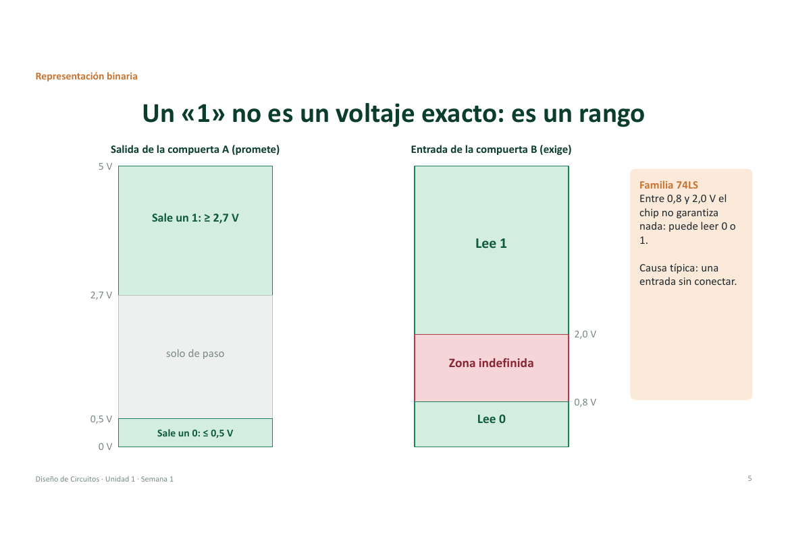

### Margen de ruido: el colchón de seguridad

- **Margen alto** = 2,7 − 2,0 = **0,7 V**. Un 1 puede perder hasta 0,7 V por el camino y se sigue leyendo como 1.
- **Margen bajo** = 0,8 − 0,5 = **0,3 V**. Un 0 puede subir hasta 0,3 V por ruido y se sigue leyendo como 0.

> **Ejemplo de falla.** Sale un 0 de 0,5 V, un motor cercano induce 0,4 V de ruido y llegan 0,9 V. Eso cae en la zona indefinida y aparece un error.

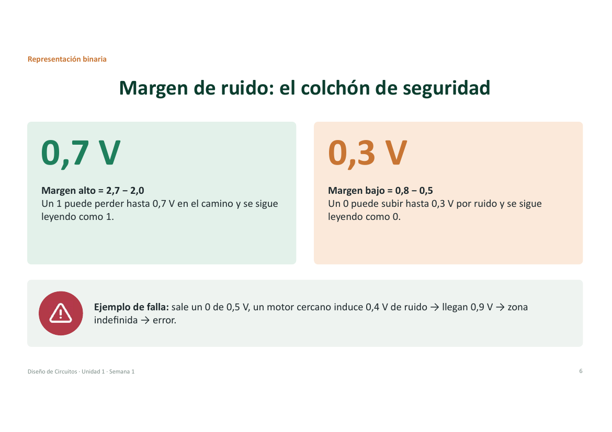

---

## 2. Sistemas numéricos

### Sistema posicional

En un sistema posicional **la posición da el valor**: cada posición vale una potencia de la base.

`555 = 5×100 + 5×10 + 5×1 = 500 + 50 + 5`

El contraejemplo son los números romanos: en XV la V vale 5 esté donde esté, y por eso sumar con romanos es tan incómodo.

### Binario

Las posiciones valen **1, 2, 4, 8, 16…**

- **Bit** = un dígito binario (*binary digit*).
- **Byte** = 8 bits.

`1011₂ = 8 + 0 + 2 + 1 = 11`

**Potencias de 2 para memorizar:**

| 2⁷ | 2⁶ | 2⁵ | 2⁴ | 2³ | 2² | 2¹ | 2⁰ |
|:---:|:---:|:---:|:---:|:---:|:---:|:---:|:---:|
| 128 | 64 | 32 | 16 | 8 | 4 | 2 | 1 |

---

## 3. Conversiones

### De decimal a binario: dividir entre 2

Se divide entre 2 una y otra vez y se **leen los restos de abajo hacia arriba**.

| División | Cociente | Resto |
|:---:|:---:|:---:|
| 25 ÷ 2 | 12 | **1** |
| 12 ÷ 2 | 6 | **0** |
| 6 ÷ 2 | 3 | **0** |
| 3 ÷ 2 | 1 | **1** |
| 1 ÷ 2 | 0 | **1** |

**25 = 11001₂**. Comprobación: 16 + 8 + 1 = 25 ✓

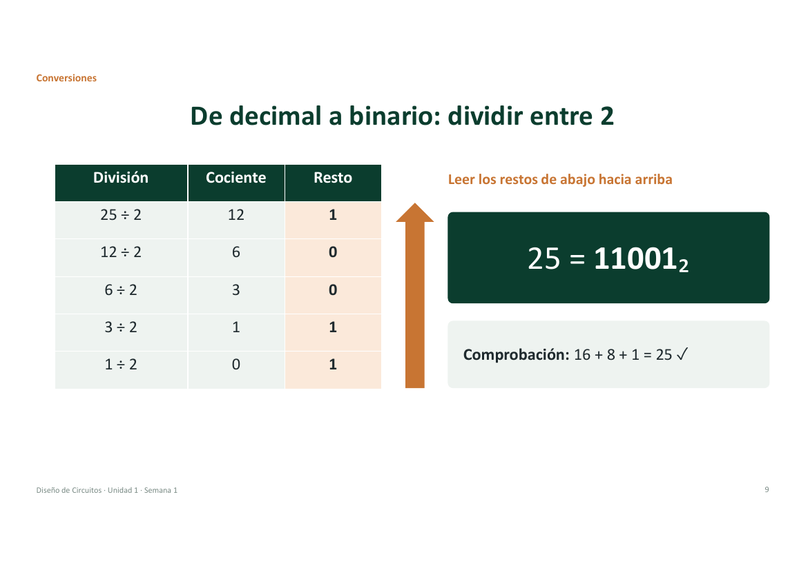

### Hexadecimal y octal: abreviaturas del binario

- **Hexadecimal:** grupos de **4 bits** desde la derecha.
- **Octal:** grupos de **3 bits** desde la derecha.
- Si falta algún bit, se completa con ceros a la izquierda.

Ejemplo con el 157:

```text
157 = 1001 1101₂
      ↓    ↓
      9    D      →  157 = 9D₁₆

157 = 010 011 101₂
       ↓   ↓   ↓
       2   3   5  →  157 = 235₈
```

| Decimal | 10 | 11 | 12 | 13 | 14 | 15 |
|:---:|:---:|:---:|:---:|:---:|:---:|:---:|
| **Hex** | A | B | C | D | E | F |

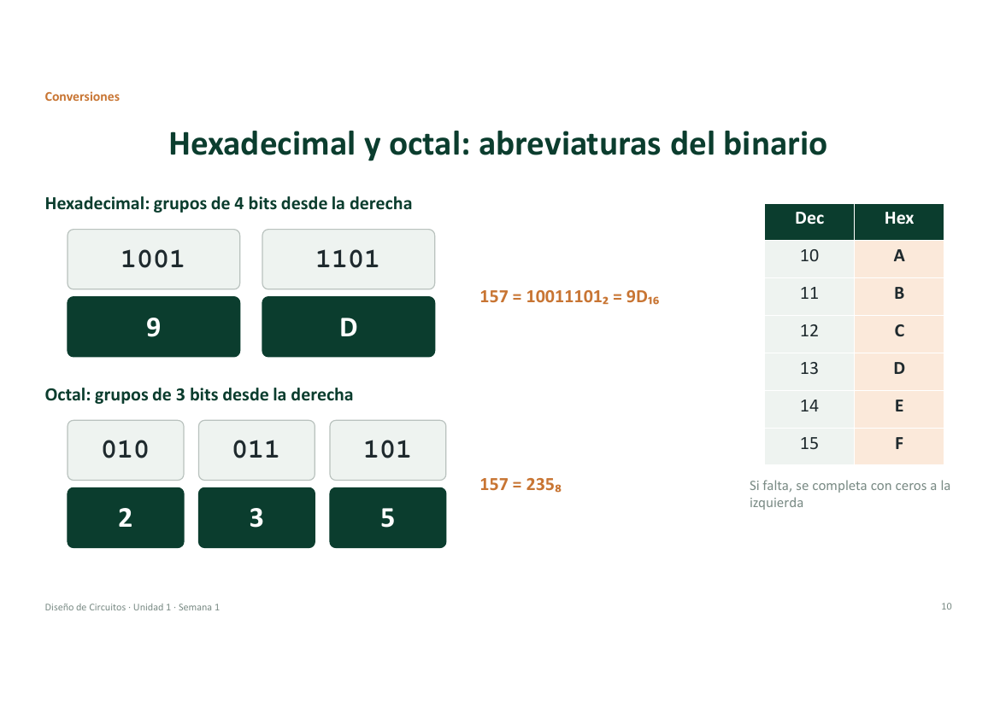

### ✍️ Actividad 1 · Reto de conversión (resuelto)

| # | Ejercicio | Resultado |
|:---:|---|---|
| 1 | 45 a binario y a hexadecimal | `101101₂` · `2D₁₆` |
| 2 | A7₁₆ a decimal | 10×16 + 7 = **167** |
| 3 | 11100101₂ a hexadecimal y a octal | `E5₁₆` · `345₈` |

<details>
<summary>Ver el procedimiento del ejercicio 3</summary>

- Hexadecimal: `1110 0101` → E y 5 → **E5**.
- Octal: se agrupa de a 3 desde la derecha, completando con un cero: `011 100 101` → 3, 4 y 5 → **345**.
- Verificación en decimal: E5₁₆ = 14×16 + 5 = 229 y 345₈ = 3×64 + 4×8 + 5 = 229 ✓

</details>

> Estas respuestas son mías (las diapositivas solo plantean los ejercicios). Compruébalas con los pesos de cada posición.

---

## 4. Aritmética binaria

### Suma binaria

Igual que en decimal, pero con acarreo:

| Operación | Resultado |
|:---:|:---:|
| 0 + 0 | 0 |
| 0 + 1 | 1 |
| 1 + 1 | **10** (escribo 0, llevo 1) |
| 1 + 1 + 1 | **11** (escribo 1, llevo 1) |

```text
acarreo   1 1 1
          1 0 1 1   (11)
        + 0 1 1 0   ( 6)
        ---------
        1 0 0 0 1   (17)
```

---

## 5. Números con signo: complemento a dos

### El problema

El circuito no tiene un símbolo «−». Piensa en un cuentakilómetros que retrocede desde 000: muestra 999. En binario pasa lo mismo, con 4 bits `0000 − 1 = 1111`. Entonces **acordamos** que `1111` significa −1, `1110` significa −2, y así sucesivamente. Ese acuerdo se llama **complemento a dos**.

### Tabla con 4 bits

| Binario | 0000 | 0001 | 0010 | 0011 | 0100 | 0101 | 0110 | 0111 |
|---|:---:|:---:|:---:|:---:|:---:|:---:|:---:|:---:|
| **Valor** | 0 | 1 | 2 | 3 | 4 | 5 | 6 | 7 |

| Binario | 1000 | 1001 | 1010 | 1011 | 1100 | 1101 | 1110 | 1111 |
|---|:---:|:---:|:---:|:---:|:---:|:---:|:---:|:---:|
| **Valor** | −8 | −7 | −6 | −5 | −4 | −3 | −2 | −1 |

- Positivos: el bit de la izquierda es **0**. Negativos: el bit de la izquierda es **1**.
- **Rango con 4 bits: de −8 a +7. Con 8 bits: de −128 a +127.**

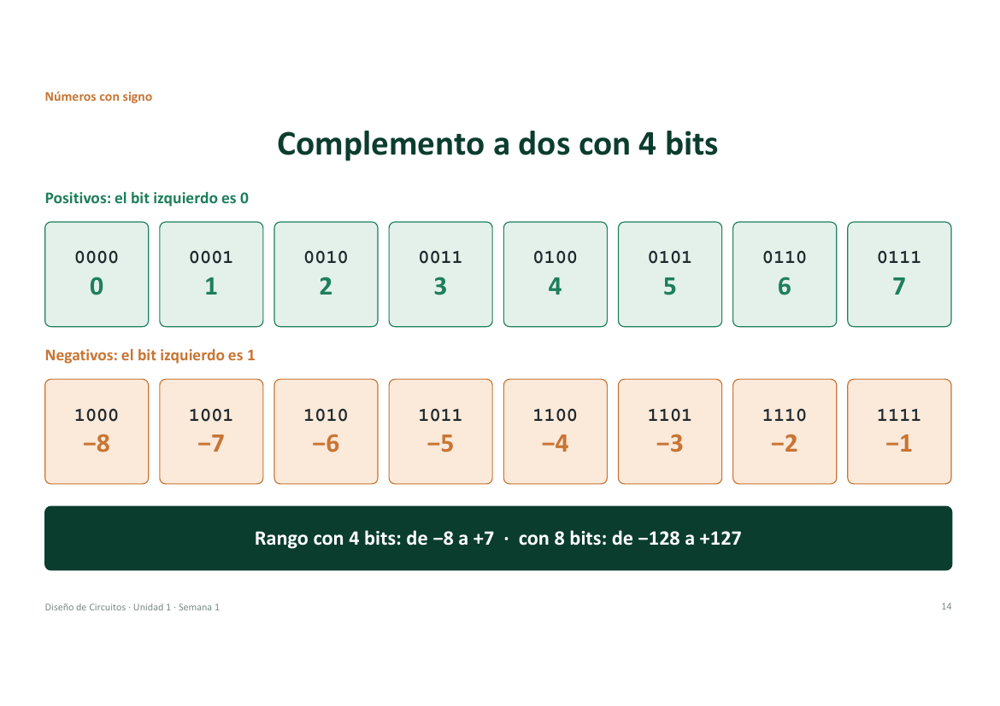

### Cómo obtener el negativo: invertir y sumar 1

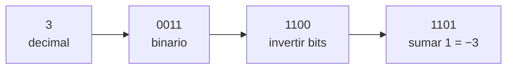

### La gran ventaja

Para restar **no hace falta un circuito restador**: el mismo sumador más inversores. Por ejemplo, `5 − 3 = 5 + (−3)`:

```text
  0101   (5)
+ 1101   (−3)
------
1 0010   → el bit que sobra a la izquierda se descarta → 0010 = 2 ✓
```

### ⚠️ Desbordamiento (overflow)

El resultado debe caber en los bits disponibles. Con 4 bits, `7 + 1`:

```text
  0111
+ 0001
= 1000  → −8 ✗
```

Dos positivos dan un negativo (o al revés). Es el mismo fenómeno que pasa con un `int` de Java:

```java
int x = 2147483647;   // el int de Java usa 32 bits en complemento a dos
x = x + 1;
// x vale -2147483648
```

> Este desbordamiento se detecta con hardware en la [Semana 4](semana-04-circuitos-aritmeticos.md).

---

## 6. Códigos

### BCD: cada dígito decimal en 4 bits

Cada dígito decimal se codifica por separado:

```text
  1      5      7
0001   0101   0111
```

- Sirve para mostrar números en **displays** (relojes, calculadoras, contadores).
- Las combinaciones **1010 a 1111 no se usan** (más adelante serán «indiferentes»).
- No confundir: el 157 en binario natural es `10011101`, que es otra cosa.

### Código Gray: entre vecinos cambia un solo bit

En binario natural, pasar de 3 a 4 es `011 → 100`: **cambian 3 bits a la vez**, y un sensor puede leer valores falsos justo en ese instante. En Gray siempre cambia **un solo bit** entre vecinos.

| 1 bit | 2 bits | 3 bits |
|:---:|:---:|:---:|
| 0 | 00 | 000 |
| 1 | 01 | 001 |
| | 11 | 011 |
| | 10 | 010 |
| | | 110 |
| | | 111 |
| | | 101 |
| | | 100 |

**Método del espejo:** copia la lista al revés debajo de la original y antepón 0 en la mitad de arriba y 1 en la de abajo.

**¿Dónde se usa?** En perillas y *encoders* rotativos, y en el orden `00, 01, 11, 10` de los mapas de Karnaugh ([Semana 3](semana-03-sesion-1-mapas-karnaugh.md)).

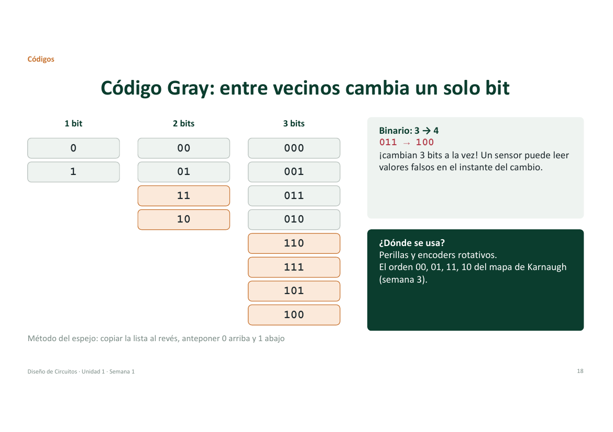

### ASCII: una tabla acordada de letras a números

- **7 bits = 128 caracteres**: letras, dígitos, signos y controles.
- La ñ y las tildes no están; para eso existe **UTF-8**.

| Letra | H | O | L | A |
|:---:|:---:|:---:|:---:|:---:|
| Decimal | 72 | 79 | 76 | 65 |
| Hexadecimal | 0x48 | 0x4F | 0x4C | 0x41 |

Y así se responde la pregunta del inicio: tu celular guarda la «A» como el número **65 = 01000001**.

---

## 7. Compuertas lógicas

Son siete: **NOT, AND, OR, NAND, NOR, XOR y XNOR**.

### Las básicas: NOT, AND, OR

| Compuerta | Idea en una frase | Expresión |
|---|---|:---:|
| **NOT** | Invierte | `Y = A'` |
| **AND** | Vale 1 solo si **todas** las entradas valen 1 | `Y = A·B` |
| **OR** | Vale 1 si **al menos una** entrada vale 1 | `Y = A+B` |

| A | NOT |
|:-:|:-:|
| 0 | 1 |
| 1 | 0 |

| A | B | AND | OR |
|:-:|:-:|:-:|:-:|
| 0 | 0 | 0 | 0 |
| 0 | 1 | 0 | 1 |
| 1 | 0 | 0 | 1 |
| 1 | 1 | 1 | 1 |

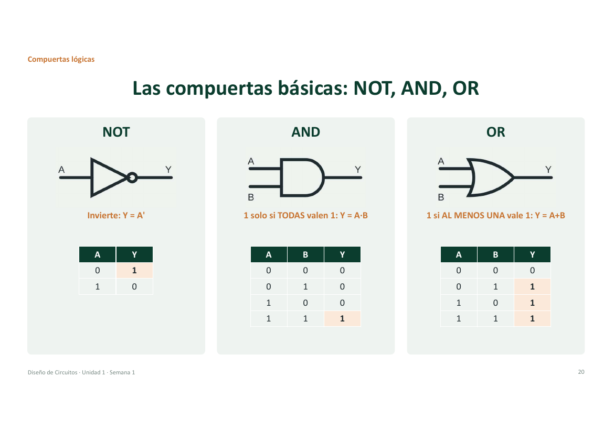

### Las negadas: NAND y NOR

El **círculo** en la salida significa «negado»: invierte el resultado.

| A | B | NAND | NOR |
|:-:|:-:|:-:|:-:|
| 0 | 0 | 1 | 1 |
| 0 | 1 | 1 | 0 |
| 1 | 0 | 1 | 0 |
| 1 | 1 | 0 | 0 |

- **NAND** (NOT-AND): vale 0 solo si todas valen 1.
- **NOR** (NOT-OR): vale 1 solo si ninguna vale 1.

> 💡 Dato para la Semana 3: con solo NAND (o solo NOR) se puede construir **cualquier** circuito.

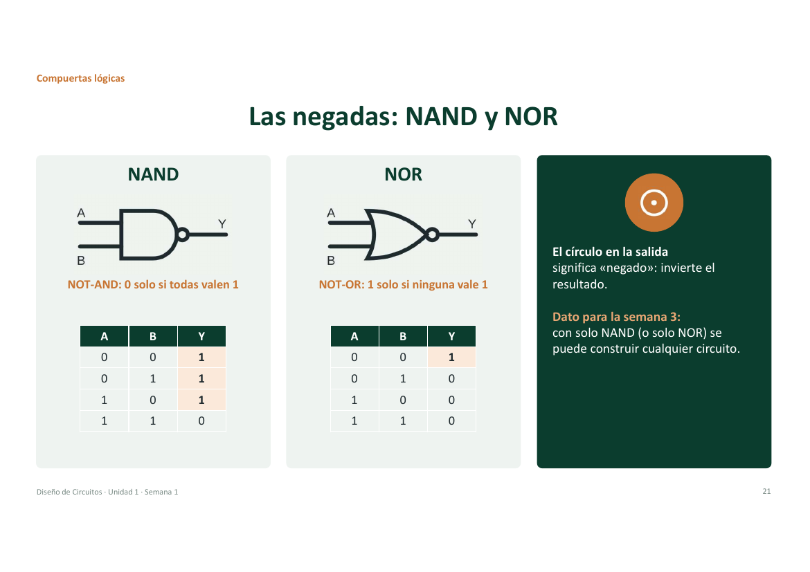

### Las de comparación: XOR y XNOR

| A | B | XOR | XNOR |
|:-:|:-:|:-:|:-:|
| 0 | 0 | 0 | 1 |
| 0 | 1 | 1 | 0 |
| 1 | 0 | 1 | 0 |
| 1 | 1 | 0 | 1 |

- **XOR**: vale 1 si las entradas son **distintas**.
- **XNOR**: vale 1 si las entradas son **iguales**.

**Ejemplo cotidiano:** la luz de una escalera con dos interruptores (abajo y arriba). Cambia cada vez que mueves cualquiera de los dos. Eso es una XOR.

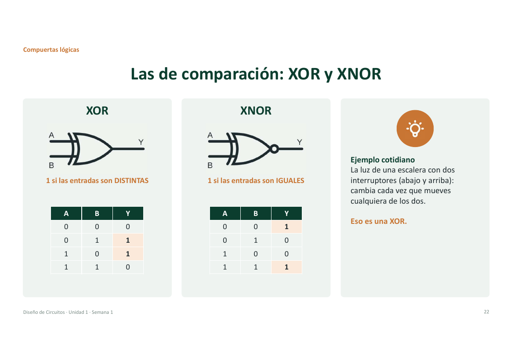

### Dos normas para dibujar la misma compuerta

Existen la norma **ANSI** (las formas curvas de siempre) y la **IEC** (rectángulos con símbolos). **En el curso usaremos ANSI.** Si el simulador muestra rectángulos, se cambia en sus opciones.

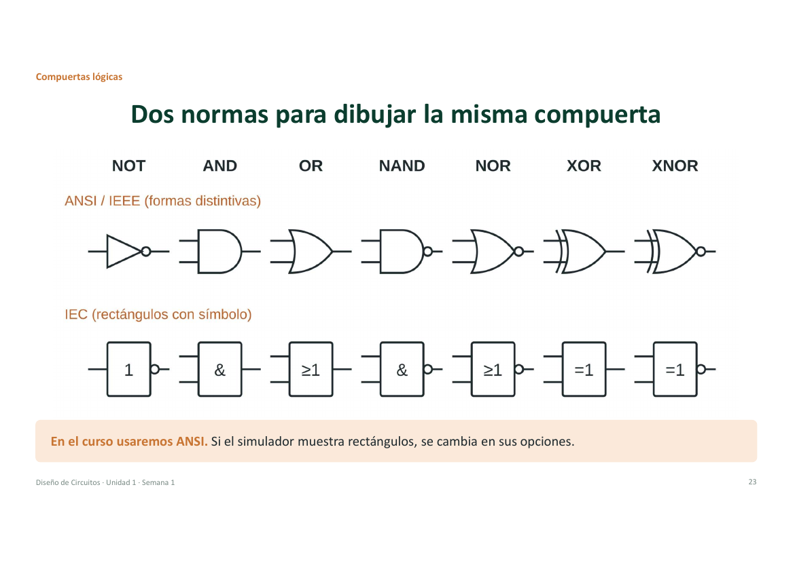

---

## 8. Las compuertas vienen en circuitos integrados: el 74LS08

El **74LS08** trae **4 compuertas AND** en un mismo chip.

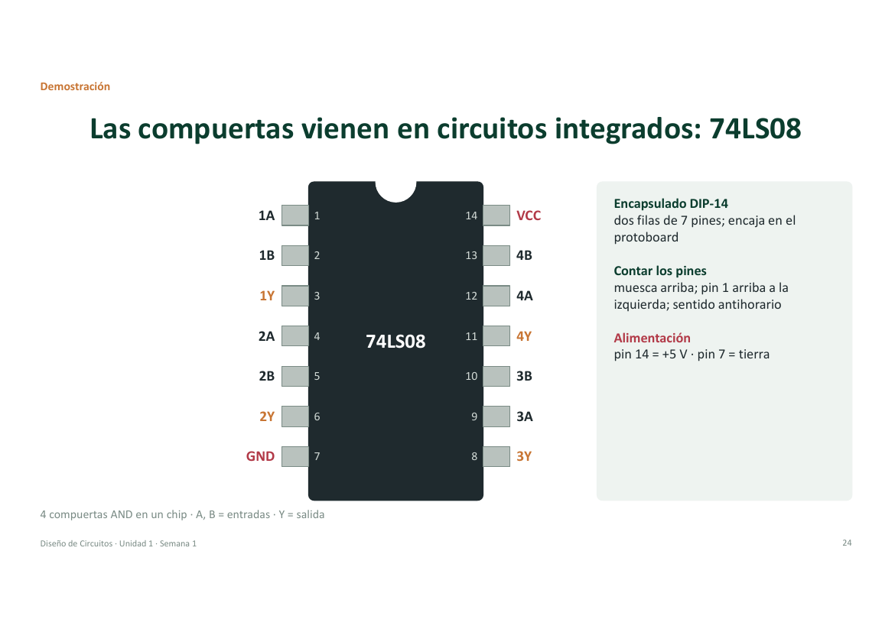

| Dato | Detalle |
|---|---|
| Encapsulado | **DIP-14**: dos filas de 7 pines, encaja en el protoboard |
| Cómo contar los pines | Muesca arriba, pin 1 arriba a la izquierda, y se cuenta en sentido antihorario |
| Alimentación | Pin **14 = +5 V** · Pin **7 = tierra (GND)** |
| Entradas y salidas | `A`, `B` = entradas · `Y` = salida (por ejemplo 1A, 1B → 1Y) |

### Cómo leer el código impreso: `SN 74 LS 08 N`

| Parte | Significa |
|:---:|---|
| **SN** | Fabricante (Texas Instruments) |
| **74** | Rango de uso: comercial (54 = militar) |
| **LS** | Familia/tecnología: LS = TTL, HC = CMOS |
| **08** | Función: 4 AND de 2 entradas |
| **N** | Encapsulado DIP de plástico |

- Para buscar la hoja de datos: «74LS08 datasheet», de preferencia en la web del fabricante (ti.com, onsemi.com).
- ¿Te venden un **74HC08**? Misma función y mismos pines; es la versión CMOS y sirve igual.


---

## ✍️ Actividad 2 · Del enunciado a la compuerta

### Ejercicio 1: ¿qué compuerta describe cada frase?

| Frase | Compuerta |
|---|:---:|
| a) La alarma suena solo si las dos puertas están abiertas | **AND** |
| b) La luz del pasillo se enciende si se pulsa cualquiera de los dos botones | **OR** |
| c) El juego marca «diferentes» si los dos jugadores eligen distinto | **XOR** |
| d) La bomba de agua se apaga cuando el sensor de nivel está activo | **NOT** |

### Ejercicio 2: tabla de verdad de `Y = A·B + C'`

Con 3 entradas hay 2³ = **8 filas**.

| Fila | A | B | C | A·B | C' | **Y** |
|:---:|:-:|:-:|:-:|:---:|:--:|:-----:|
| 0 | 0 | 0 | 0 | 0 | 1 | **1** |
| 1 | 0 | 0 | 1 | 0 | 0 | **0** |
| 2 | 0 | 1 | 0 | 0 | 1 | **1** |
| 3 | 0 | 1 | 1 | 0 | 0 | **0** |
| 4 | 1 | 0 | 0 | 0 | 1 | **1** |
| 5 | 1 | 0 | 1 | 0 | 0 | **0** |
| 6 | 1 | 1 | 0 | 1 | 1 | **1** |
| 7 | 1 | 1 | 1 | 1 | 0 | **1** |

La columna «Fila» es el *bonus* del enunciado: cada combinación ABC leída como número decimal. Las filas donde Y = 1 son 0, 2, 4, 6 y 7.

> Respuestas propuestas por mí; las diapositivas solo plantean los ejercicios.

---

## 📝 Resumen de la semana

| Tema | Idea clave |
|---|---|
| **Dos estados** | 0 y 1 son rangos de voltaje; entre ellos hay una zona indefinida |
| **Bases** | Binario = potencias de 2 · hexadecimal = grupos de 4 bits · octal = grupos de 3 bits |
| **Complemento a dos** | Negativo = invertir y sumar 1 · restar = sumar el negativo |
| **Códigos** | BCD para displays · Gray para sensores · ASCII para texto |
| **7 compuertas** | NOT, AND, OR, NAND, NOR, XOR, XNOR, cada una con su tabla de verdad |
| **Hoja de datos** | Pines, alimentación (14 y 7) y función del 74LS08 |

## 📌 Tarea y próxima sesión

- 📖 Lectura del apartado de **sistemas numéricos y códigos** del texto base (aula virtual).
- ✅ **Cuestionario 01** en el aula virtual, después de la lectura.
- 💻 Instalar **Logisim-evolution** desde GitHub (*Releases*): instalador `.msi` para Windows o `.dmg` para macOS.
- 🧪 **Práctica APE 01** (martes): comprobación de compuertas en el simulador. Traer la laptop si es posible.

---

[⬅️ Volver al índice](../README.md) · [Semana 2 ➡️](semana-02-algebra-boole-formas-canonicas.md)
