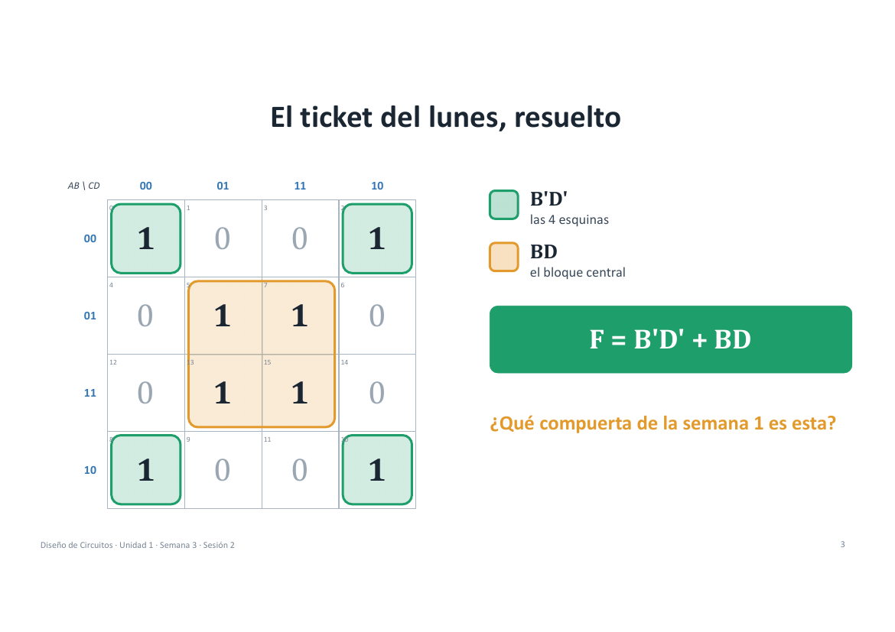
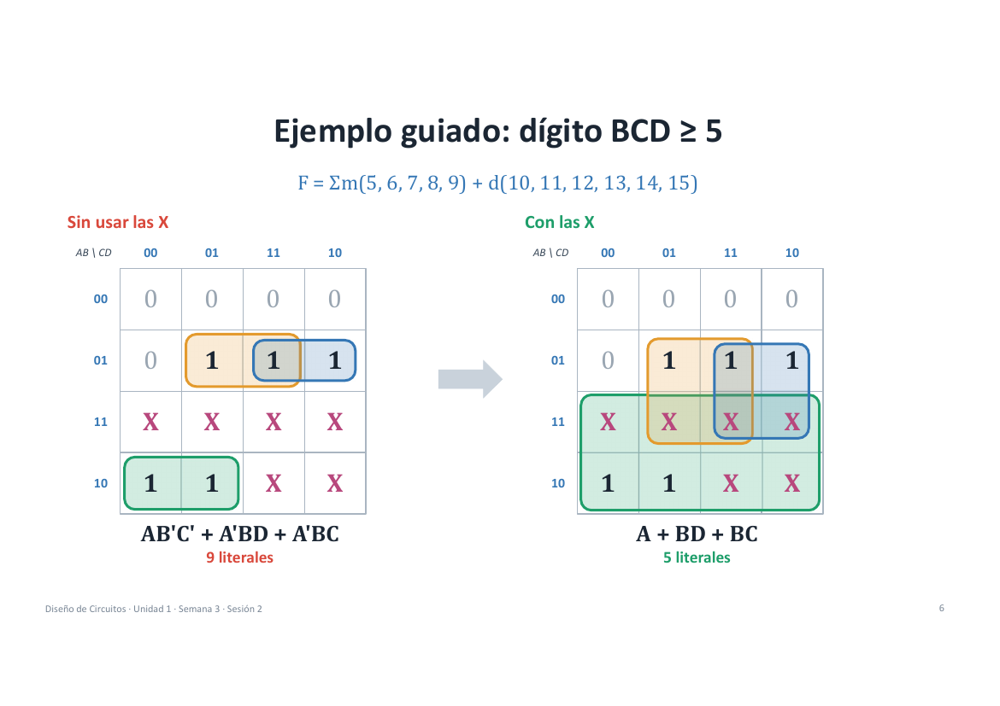
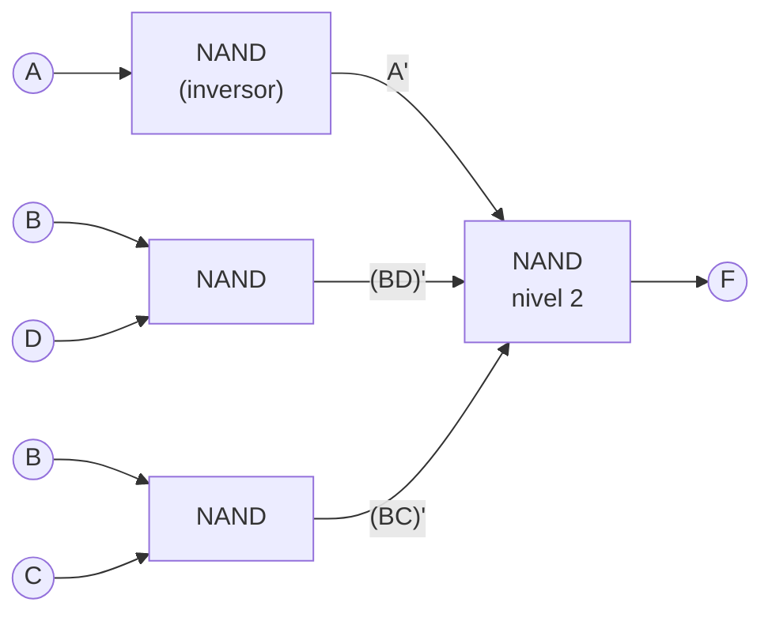
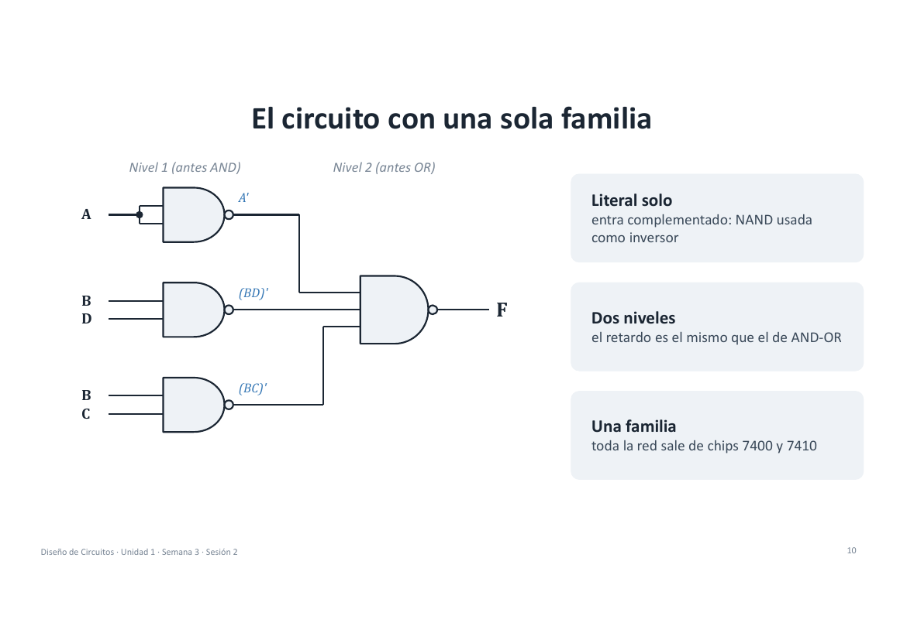
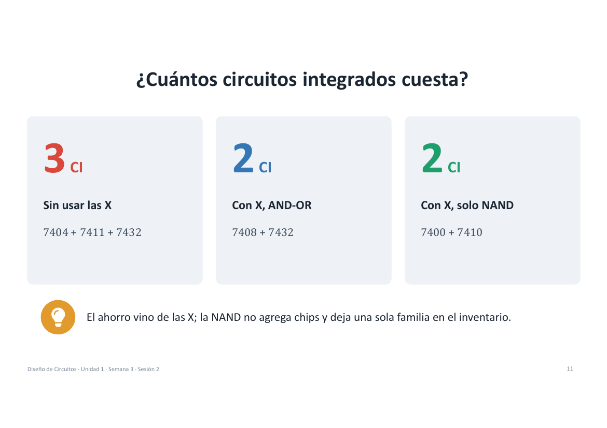

# Semana 3 · Sesión 2 · Indiferentes y NAND/NOR

> **Diseño de Circuitos · Unidad 1** · Ing. Luis Darío Sinche Cueva, Mg.
> Resultado de aprendizaje **R1**: minimizar una función de 4 variables con condiciones indiferentes e implementarla solo con compuertas NAND, cuantificando el ahorro en compuertas y circuitos integrados.

[⬅️ Semana 3 · S1](semana-03-sesion-1-mapas-karnaugh.md) · [Índice](../README.md) · [Semana 4 ➡️](semana-04-circuitos-aritmeticos.md)

---

## 🎯 Agenda de la sesión

| Tiempo | Actividad |
|:-:|---|
| 5 min | Recuperación: el ticket del lunes |
| 20 min | Condiciones indiferentes |
| 15 min | Universalidad NAND y NOR |
| 20 min | Lanzamiento del proyecto integrador |

---

## 1. El ticket del lunes, resuelto

`F(A,B,C,D) = Σm(0, 2, 5, 7, 8, 10, 13, 15)`

| AB \ CD | 00 | 01 | 11 | 10 |
|:-:|:-:|:-:|:-:|:-:|
| **00** | **1** | 0 | 0 | **1** |
| **01** | 0 | **1** | **1** | 0 |
| **11** | 0 | **1** | **1** | 0 |
| **10** | **1** | 0 | 0 | **1** |

| Grupo | Término |
|---|:---:|
| Las 4 esquinas | `B'D'` |
| El bloque central | `BD` |

### `F = B'D' + BD`

La pregunta del docente: **¿qué compuerta de la semana 1 es esta?** Vale 1 cuando B y D son **iguales**: es una **XNOR**.



---

## 2. Condiciones indiferentes (don't care)

### Combinaciones que nunca ocurren

Un dígito **BCD** usa 4 bits, pero solo 10 de las 16 combinaciones (0000 a 1001). Las combinaciones **1010 a 1111 jamás aparecen** en la entrada.

| 0 | 1 | 2 | 3 | 4 | 5 | 6 | 7 | 8 | 9 |
|:-:|:-:|:-:|:-:|:-:|:-:|:-:|:-:|:-:|:-:|
| 0000 | 0001 | 0010 | 0011 | 0100 | 0101 | 0110 | 0111 | 1000 | 1001 |

| 10 | 11 | 12 | 13 | 14 | 15 |
|:-:|:-:|:-:|:-:|:-:|:-:|
| X | X | X | X | X | X |

Entonces, ¿qué debe hacer el circuito con 1010 a 1111? **Lo que más nos convenga.** A esas filas se las marca con **X** (indiferente).

### Cómo usar las X en el mapa

| Regla | Qué significa |
|---|---|
| ✅ **Como 1** | Si agranda un grupo, se incluye: el término queda más corto |
| 🔵 **Como 0** | Si no ayuda, se ignora. Ninguna X está obligada a quedar cubierta |
| ❌ **Nunca sola** | Un grupo formado solo por X agrega un término inútil |

**Notación:** `F = Σm(minitérminos) + d(indiferentes)`.

---

## 3. Ejemplo guiado: dígito BCD ≥ 5

```text
F = Σm(5, 6, 7, 8, 9) + d(10, 11, 12, 13, 14, 15)
```

### Sin usar las X

| AB \ CD | 00 | 01 | 11 | 10 |
|:-:|:-:|:-:|:-:|:-:|
| **00** | 0 | 0 | 0 | 0 |
| **01** | 0 | **1** | **1** | **1** |
| **11** | X | X | X | X |
| **10** | **1** | **1** | X | X |

Ignorando las X queda `AB'C' + A'BD + A'BC` → **9 literales**.

### Con las X

Las X se vuelven 1 donde ayudan:

| Grupo | Término |
|---|:---:|
| Toda la mitad inferior (filas 11 y 10) | `A` |
| Columna 01-11 en filas 01 y 11 | `BD` |
| Columna 11-10 en filas 01 y 11 | `BC` |

### `F = A + BD + BC` → **5 literales**



El ahorro de 9 a 5 literales vino **íntegro de las X**.

---

## 4. Con NAND se construye todo

| | NOT con NAND | AND con NAND | OR con NAND |
|---|:---:|:---:|:---:|
| Construcción | `(A·A)' = A'` | `((AB)')' = AB` | `(A'·B')' = A + B` |
| Cómo | Se unen las dos entradas | NAND seguida de una NAND-inversor | Se invierte cada entrada y luego una NAND |

> Si NOT, AND y OR se construyen con NAND, **cualquier función** también.

### NOR es el caso dual

| Función | Solo NAND | Solo NOR |
|:-:|:-:|:-:|
| NOT | `(A·A)'` | `(A + A)'` |
| AND | `((AB)')'` | `(A' + B')'` |
| OR | `(A'·B')'` | `((A + B)')'` |

| Si la forma mínima es… | Conviene la familia… |
|:-:|:-:|
| **SOP** | **NAND-NAND** |
| **POS** | **NOR-NOR** |

> La forma mínima elegida decide la familia que conviene.

---

## 5. De SOP a NAND-NAND en cuatro pasos

Tomamos `F = A + BD + BC`:

| Paso | Expresión | Qué se hizo |
|:-:|---|---|
| 1 | `F = A + BD + BC` | SOP mínima del ejemplo |
| 2 | `F = ((A + BD + BC)')'` | **Doble negación**: no cambia nada |
| 3 | `F = (A' · (BD)' · (BC)')'` | **De Morgan** sobre la negación interna |
| 4 | `F = NAND( A', NAND(B,D), NAND(B,C) )` | Cada paréntesis es una NAND |

### El circuito con una sola familia





Tres cosas para notar:

- **Literal solo:** entra **complementado**; es una NAND usada como inversor. Por eso `A` entra como `A'` y B, C y D no (pregunta del *piensa, pareja, comparte*).
- **Dos niveles:** el retardo es el mismo que el de AND-OR.
- **Una familia:** toda la red sale de chips **7400** (NAND de 2 entradas) y **7410** (NAND de 3 entradas).

---

## 6. ¿Cuántos circuitos integrados cuesta?

| Versión | Chips | Total |
|---|---|:---:|
| **Sin usar las X** | 7404 + 7411 + 7432 | **3 CI** |
| **Con X, AND-OR** | 7408 + 7432 | **2 CI** |
| **Con X, solo NAND** | 7400 + 7410 | **2 CI** |



> 💡 **El ahorro vino de las X.** La NAND no agrega chips y deja una sola familia en el inventario.

---

## 7. 🧠 Piensa, pareja, comparte

1 min individual · 2 min con tu compañero · 2 min al curso.

**1. ¿Por qué A entra complementada en el circuito NAND-NAND, y B, C y D no?**

Porque `A` aparece sola como término (`F = A + …`). En el segundo nivel la NAND necesita recibir los términos *negados*, y un literal solo se niega pasándolo por una NAND como inversor. Los términos `BD` y `BC` ya salen negados de su propia NAND de primer nivel.

**2. Convierta `F = A'C' + BC` (taller T2) a NAND-NAND. ¿Cuántos chips 7400 necesita?** *(propuesta mía)*

```text
F = A'C' + BC
  = ((A'C')' · (BC)')'
```

| Compuerta | Función |
|:-:|---|
| NAND (inversor) | `A'` |
| NAND (inversor) | `C'` |
| NAND | `(A'C')'` |
| NAND | `(BC)'` |
| NAND (salida) | `F` |

Son **5 compuertas NAND**. Como cada 7400 trae 4 compuertas, se necesitan **2 chips 7400**.

---

## 8. 🚀 Proyecto integrador: un sistema, tres versiones

| Entrega | Semana | Qué se hace |
|:-:|:-:|---|
| **1** | 6 · Unidad 1 | **Bloque combinacional:** tabla de verdad, expresión mínima y esquema simulado en Logisim-evolution |
| **2** | 11 · Unidad 2 | **Se agrega la memoria:** diagrama de estados, flip-flops y esquema completo simulado |
| **3** | 16 · Unidad 3 | **Descrito en VHDL:** simulación funcional, configuración de la Basys 3 y sustentación individual |

Al final, cada equipo **contrasta su solución clásica con la moderna**.

### 8 equipos, 4 roles rotativos, 1 Basys 3

| Rol | Qué hace |
|---|---|
| 📋 **Especificación** | Traduce el enunciado a entradas, salidas y casos de prueba |
| ✏️ **Diseño** | Obtiene la tabla, la expresión mínima y el esquema |
| 🧪 **Verificación** | Simula, compara con lo predicho y reporta discrepancias |
| 📝 **Documentación** | Redacta el informe y la declaración de uso de IA |

**La placa Basys 3 (una por equipo):** 16 interruptores · 5 pulsadores · 16 LED · 4 dígitos de 7 segmentos. *El sistema debe caber en estos recursos.*

Ese día: **sorteo de temas y acta de conformación**. Los roles **rotan en cada entrega**.

---

## 📝 Resumen

| Tema | Idea clave |
|---|---|
| **Indiferentes** | Valen 1 si agrandan un grupo y 0 si no; nunca se agrupan solas |
| **Universalidad** | NOT, AND y OR se construyen solo con NAND o solo con NOR |
| **Conversión** | SOP → NAND-NAND y POS → NOR-NOR; el literal solo se complementa |
| **Costo** | Se compara en literales y en chips: el mínimo algebraico no siempre es el más barato |

## 📌 Para la próxima

- 📖 **Cuestionario de autoevaluación 03** en el EVA, después de leer el apartado de Karnaugh e indiferentes (Carpinelli, 2023).
- 🧪 **APE 03 (martes 27):** traer el diseño previo en papel: mapa resuelto y conversión a NAND de la función de la guía.
- 👥 **Proyecto integrador:** acta de conformación del equipo y lectura de la guía y la rúbrica en el EVA.

---

[⬅️ Semana 3 · S1](semana-03-sesion-1-mapas-karnaugh.md) · [Índice](../README.md) · [Semana 4 ➡️](semana-04-circuitos-aritmeticos.md)
