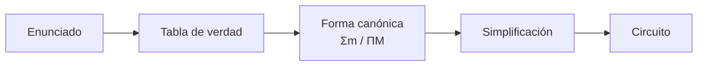
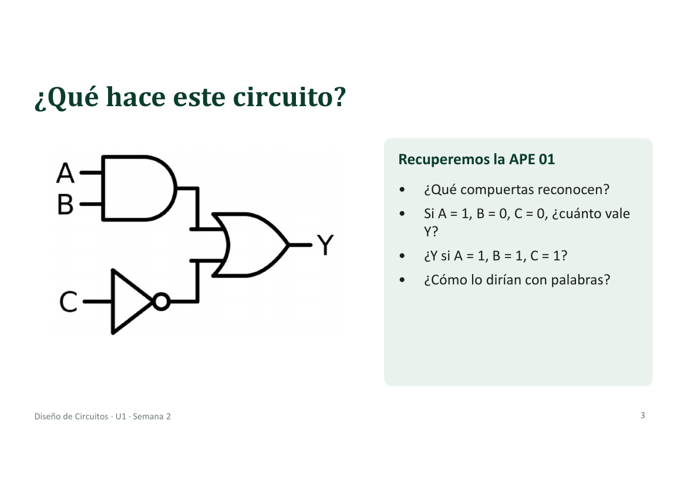
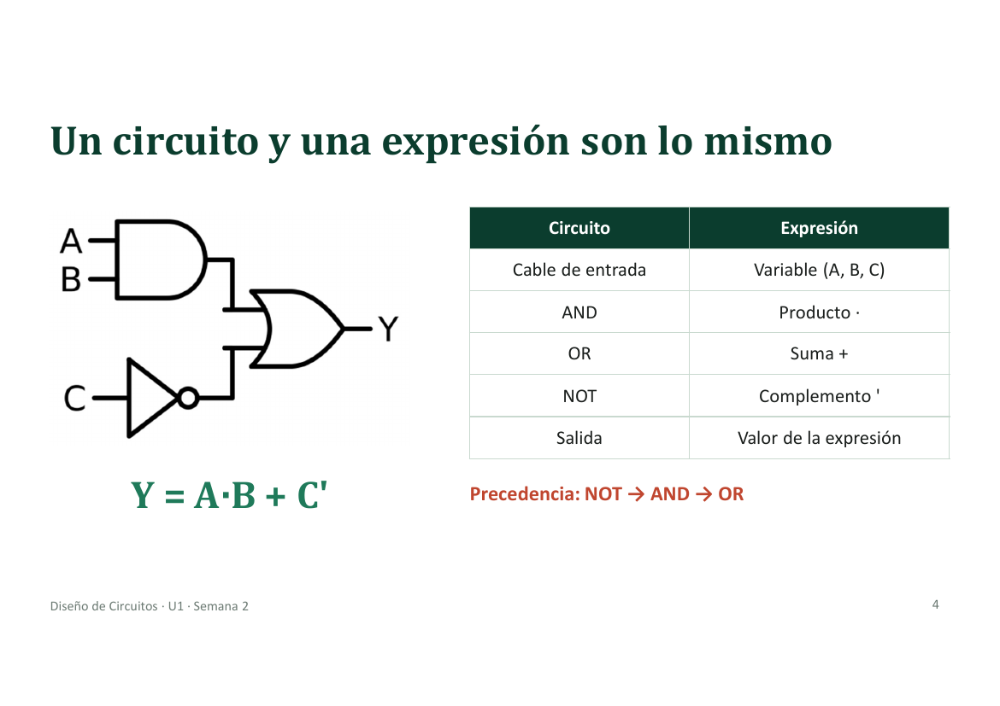
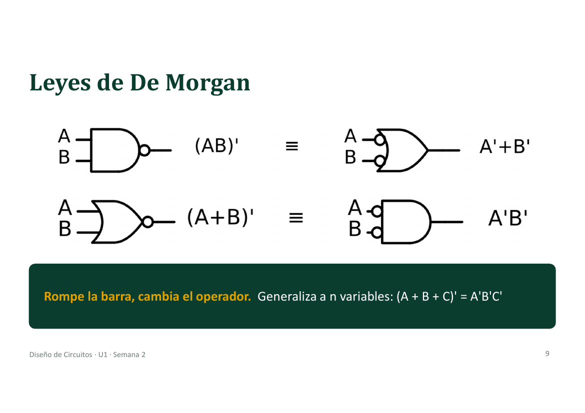
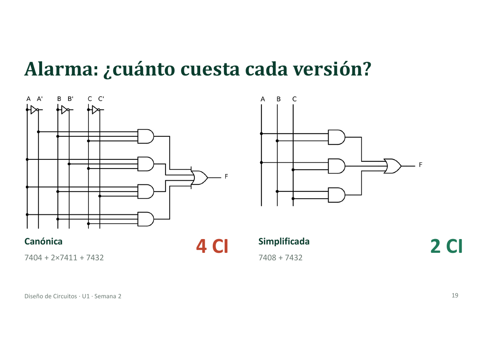

# Semana 2 · Álgebra de Boole y formas canónicas

> **Diseño de Circuitos · Unidad 1** · Ing. Luis Darío Sinche Cueva, Mg.
> Resultado de aprendizaje **R1**: diseña e implementa circuitos combinacionales básicos utilizando técnicas de diseño clásico.

[⬅️ Semana 1](semana-01-sistemas-numericos-compuertas.md) · [Índice](../README.md) · [Semana 3 · S1 ➡️](semana-03-sesion-1-mapas-karnaugh.md)

---

## 🎯 Qué se busca esta semana

Pasar de **un enunciado** a la **tabla de verdad**, de ahí a la **forma canónica** y, por último, a un **circuito simplificado**.



---

## 1. Un circuito y una expresión son lo mismo



Tiene una AND (entradas A y B), una NOT (entrada C) y una OR que junta ambas. Escrito como expresión:

### `Y = A·B + C'`

| Circuito | Expresión |
|---|---|
| Cable de entrada | Variable (A, B, C) |
| AND | Producto `·` |
| OR | Suma `+` |
| NOT | Complemento `'` |
| Salida | Valor de la expresión |

**Precedencia de operadores:** primero **NOT**, luego **AND**, al final **OR**.



- Si A = 1, B = 0, C = 0 → `Y = 0 + 1 = ` **1**
- Si A = 1, B = 1, C = 1 → `Y = 1 + 0 = ` **1**
- En palabras: *«Y vale 1 si A y B están ambas en 1, o si C está en 0»*.

---

## 2. Del enunciado a la especificación

Un mismo enunciado se puede leer de dos maneras, y hay que decidir cuál pide el cliente.

> «La sirena suena cuando se activan dos sensores.»

| | Lectura 1: **exactamente** dos | Lectura 2: **al menos** dos |
|---|---|---|
| Filas | 011, 101, 110 | 011, 101, 110, **111** |
| Función | `F = Σm(3, 5, 6)` | `F = Σm(3, 5, 6, 7)` |
| Con los tres activos | No suena! | Suena |
| ¿Cuál se usa? | | ✅ **Es la que pide el cliente** |

La lección: antes de dibujar compuertas, hay que interpretar bien el enunciado.

---

## 3. Álgebra de Boole: postulados de Huntington

Trabajamos con el conjunto `{0, 1}` y tres operaciones: `+` (OR), `·` (AND) y `'` (NOT).

| Postulado | Forma OR | Forma AND (dual) |
|---|:---:|:---:|
| Identidad | `X + 0 = X` | `X · 1 = X` |
| Complemento | `X + X' = 1` | `X · X' = 0` |
| Conmutativa | `X + Y = Y + X` | `XY = YX` |
| Distributiva | `X(Y + Z) = XY + XZ` | `X + YZ = (X + Y)(X + Z)` |

---

## 4. Teoremas: tabla de consulta


| Teorema | Forma OR | Forma AND |
|---|:---:|:---:|
| Elemento nulo | `X + 1 = 1` | `X · 0 = 0` |
| Idempotencia | `X + X = X` | `X · X = X` |
| Involución | `(X')' = X` | |
| Absorción | `X + XY = X` | `X(X + Y) = X` |
| Absorción del complemento | `X + X'Y = X + Y` | `X(X' + Y) = XY` |
| Adyacencia | `XY + XY' = X` | `(X + Y)(X + Y') = X` |
| Consenso | `XY + X'Z + YZ = XY + X'Z` | `(X+Y)(X'+Z)(Y+Z) = (X+Y)(X'+Z)` |

---

## 5. Leyes de De Morgan


```text
(A·B)' = A' + B'          (A + B)' = A'·B'
```

Se generalizan a n variables: `(A + B + C)' = A'B'C'`.

En circuitos: una NAND equivale a una OR con las entradas negadas, y una NOR equivale a una AND con las entradas negadas.




| # | Expresión | Resultado |
|:-:|---|---|
| 1 | `(A·B·C)'` | `A' + B' + C'` |
| 2 | `(A + B'C)'` | `A'·(B + C')` |
| 3 | `(A'B + C)'` | `(A + B')·C'` |

Y se verifica con una fila de la tabla de verdad. Por ejemplo, para el 1 con A = B = C = 1: `(1·1·1)' = 0` y `0'+0'+0' = 0` ✓.

---

## 6. Minitérminos y maxitérminos

Son las **8 piezas posibles** de una función de 3 variables. Aún no hay función `F`; cada función elige cuáles usa.

| i | A | B | C | Minitérmino `mᵢ` (vale 1) | Maxitérmino `Mᵢ` (vale 0) |
|:-:|:-:|:-:|:-:|:---:|:---:|
| 0 | 0 | 0 | 0 | `A'B'C'` | `A + B + C` |
| 1 | 0 | 0 | 1 | `A'B'C` | `A + B + C'` |
| 2 | 0 | 1 | 0 | `A'BC'` | `A + B' + C` |
| 3 | 0 | 1 | 1 | `A'BC` | `A + B' + C'` |
| 4 | 1 | 0 | 0 | `AB'C'` | `A' + B + C` |
| 5 | 1 | 0 | 1 | `AB'C` | `A' + B + C'` |
| 6 | 1 | 1 | 0 | `ABC'` | `A' + B' + C` |
| 7 | 1 | 1 | 1 | `ABC` | `A' + B' + C'` |

**Cómo construirlos:**

- **Minitérmino `mᵢ`** → es un **producto**. Variable en 1 → sin complemento; variable en 0 → complementada.
- **Maxitérmino `Mᵢ`** → es una **suma**. Variable en 0 → sin complemento; variable en 1 → complementada.
- Siempre se cumple `Mᵢ = (mᵢ)'`.

---

## 7. SOP y POS: una función, dos descripciones

Tomamos la tabla de la sirena (al menos 2 sensores):

| i | A | B | C | **F** |
|:-:|:-:|:-:|:-:|:-:|
| 0 | 0 | 0 | 0 | 0 |
| 1 | 0 | 0 | 1 | 0 |
| 2 | 0 | 1 | 0 | 0 |
| 3 | 0 | 1 | 1 | **1** |
| 4 | 1 | 0 | 0 | 0 |
| 5 | 1 | 0 | 1 | **1** |
| 6 | 1 | 1 | 0 | **1** |
| 7 | 1 | 1 | 1 | **1** |

### SOP (suma de productos): se leen las filas donde F = 1

Por cada fila con `F = 1` tomo su minitérmino y los uno con **OR**.

```text
F = Σm(3, 5, 6, 7) = A'BC + AB'C + ABC' + ABC
```

*«F vale 1 si la entrada es la combinación 3, o la 5, o la 6, o la 7».*

### POS (producto de sumas): se leen las filas donde F = 0

Por cada fila con `F = 0` tomo su maxitérmino y los uno con **AND**.

```text
F = ΠM(0, 1, 2, 4) = (A+B+C)(A+B+C')(A+B'+C)(A'+B+C)
```

*«F vale 1 si la entrada no es la 0, y no es la 1, y no es la 2, y no es la 4».*

> Entre ambas listas están todas las filas (0 a 7): **los índices de ΠM son los que faltan en Σm**.

---

## 8. Resolución guiada: alarma de 3 sensores

### Enunciado

Una bodega tiene tres sensores: **puerta (A)**, **ventana (B)** y **movimiento (C)**. Para evitar falsas alarmas, la sirena **F** suena si **al menos dos** sensores se activan. (La tabla de verdad es la de la sección anterior.)

### De la canónica a la simplificada

Se parte de la SOP canónica y se usa la idempotencia (`ABC = ABC + ABC + ABC`) para que el término `ABC` sirva en tres pares:

```text
F = A'BC + AB'C + ABC' + ABC

A'BC + ABC = BC(A' + A) = BC
AB'C + ABC = AC(B' + B) = AC
ABC' + ABC = AB(C' + C) = AB

F = AB + AC + BC
```

La versión POS simplificada sale como `F = (A + B)(A + C)(B + C)`.




---

## 9. Simplificar con álgebra: procedimiento

| Paso | Técnica | Regla |
|:-:|---|:---:|
| 1 | Buscar pares adyacentes | `XY + XY' = X` |
| 2 | Duplicar un término si hace falta | `X = X + X` |
| 3 | Absorción | `X + XY = X` |
| 4 | Absorción del complemento | `X + X'Y = X + Y` |
| 5 | Consenso | `XY + X'Z + YZ = XY + X'Z` |

> ⚠️ **No existe un algoritmo que garantice el mínimo.** En la semana siguiente aparecen los mapas de Karnaugh para los minimos.

### Ejemplo: `F = A + A'B + AB'C`

```text
F = A + A'B + AB'C
  = (A + B) + AB'C        absorción del complemento: A + A'B = A + B
  = A + AB'C + B          conmutativa
  = A + B                 absorción: A + A(B'C) = A
```

Pasamos de **3 términos (5 literales)** a una sola OR de 2 entradas. Comprobación con la fila `A=0, B=0, C=1`: la original da `0 + 0 + 0 = 0` y `A + B = 0` ✓.

---

## 10. Ejercicios
| Grupos | Problema | Enunciado |
|:-:|---|---|
| **G1 · G5** | Luz de pasillo | Dos interruptores A y B conmutan la luz; el interruptor maestro M (= 1) la apaga siempre |
| **G2 · G6** | Detector de primos | Entrada de 3 bits ABC (0–7). F = 1 si el número es primo |
| **G3 · G7** | Bomba de agua | Enciende si hay agua en la cisterna (B) y el tanque está bajo (A) o se pide en manual (C) |
| **G4 · G8** | Aviso de cinturón | Suena si el motor está encendido (E) y el cinturón no está puesto (C) o la puerta está abierta (P) |

**Hay que entregar:** tabla · Σm y ΠM · SOP canónica · versión simplificada · recuento de compuertas y CI.

### 💡 Propuestas de solución (mías, para contrastar)

| Problema | Σm | ΠM | Simplificada |
|---|---|---|---|
| Luz de pasillo (orden A, B, M) | `Σm(2, 4)` | `ΠM(0, 1, 3, 5, 6, 7)` | `F = M'·(A ⊕ B)` |
| Detector de primos (ABC) | `Σm(2, 3, 5, 7)` | `ΠM(0, 1, 4, 6)` | `F = A'B + AC` |
| Bomba de agua (orden A, B, C) | `Σm(3, 6, 7)` | `ΠM(0, 1, 2, 4, 5)` | `F = B·(A + C) = AB + BC` |
| Aviso de cinturón (orden E, C, P) | `Σm(5, 6, 7)` | `ΠM(0, 1, 2, 3, 4)` | `F = E·(C + P) = EC + EP` |

---

## 📝 Resumen de la semana

| Idea | Detalle |
|---|---|
| ✅ **Circuito = expresión** | Lo que simplificas en papel lo ahorras en hardware |
| ✅ **La tabla manda** | Dos expresiones son equivalentes si y solo si tienen la misma tabla de verdad |
| ✅ **Canónica: siempre se puede** | `Σm` (filas con 1) y `ΠM` (filas con 0); es única |
| ✅ **Simplificar = elegir por costo** | Menos compuertas, CI y niveles. El álgebra no garantiza el mínimo |

---

[⬅️ Semana 1](semana-01-sistemas-numericos-compuertas.md) · [Índice](../README.md) · [Semana 3 · S1 ➡️](semana-03-sesion-1-mapas-karnaugh.md)
