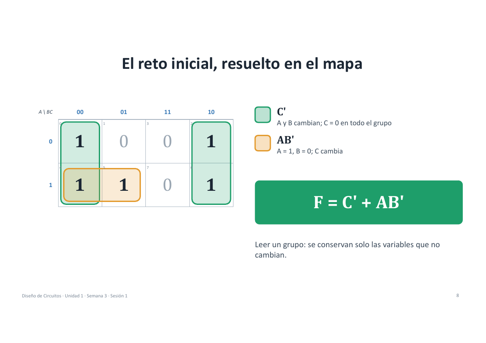
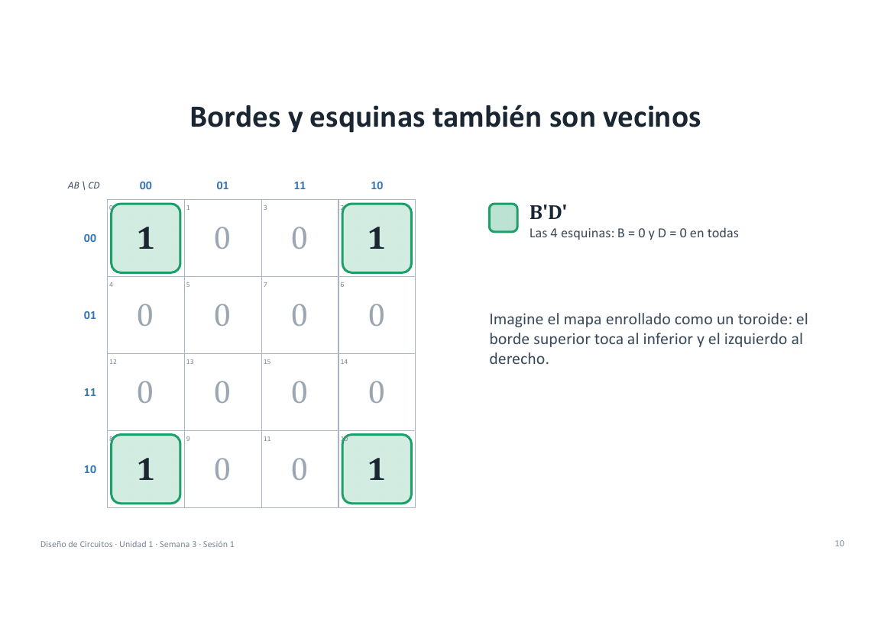
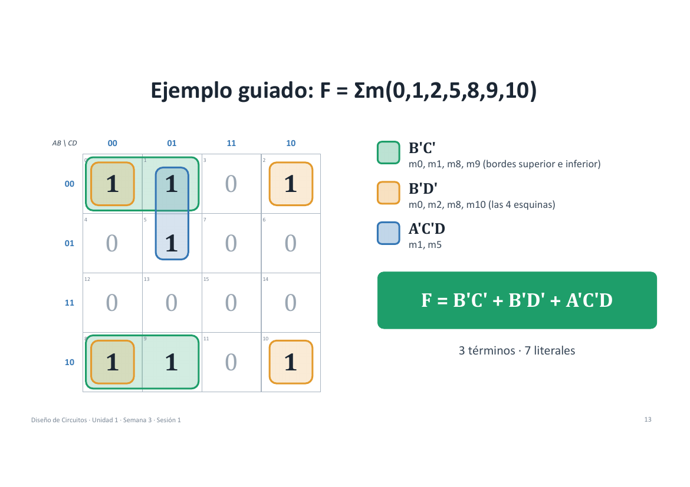
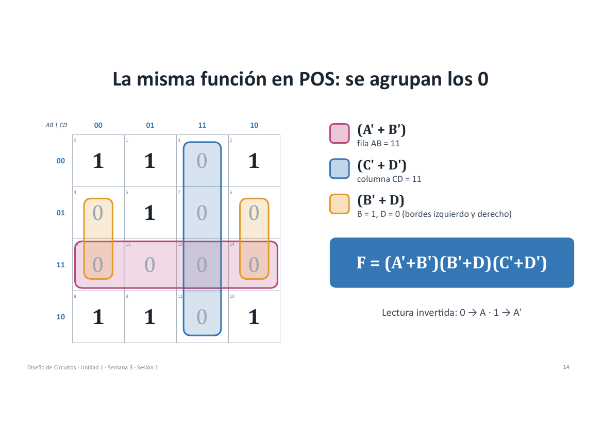
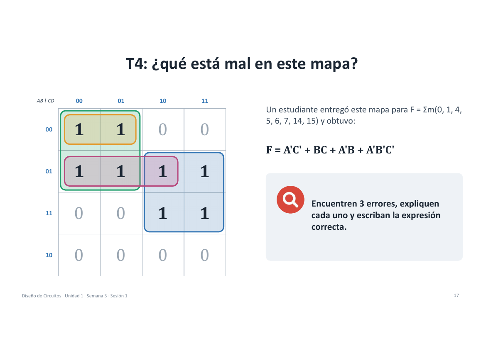

# Semana 3 · Sesión 1 · Mapas de Karnaugh

> **Diseño de Circuitos · Unidad 1** · Ing. Luis Darío Sinche Cueva, Mg.
> Resultado de aprendizaje **R1**: obtener la expresión mínima en SOP y en POS de funciones de 3 y 4 variables mediante mapas de Karnaugh, **justificando cada agrupación**.

[⬅️ Semana 2](semana-02-algebra-boole-formas-canonicas.md) · [Índice](../README.md) · [Semana 3 · S2 ➡️](semana-03-sesion-2-indiferentes-nand-nor.md)

---

## 1. El problema del mínimo


Simplificar con el álgebra de Boole:        

```text
F(A,B,C) = Σm(0, 2, 4, 5, 6)
```

| A | B | C | F |
|:-:|:-:|:-:|:-:|
| 0 | 0 | 0 | **1** |
| 0 | 0 | 1 | 0 |
| 0 | 1 | 0 | **1** |
| 0 | 1 | 1 | 0 |
| 1 | 0 | 0 | **1** |
| 1 | 0 | 1 | **1** |
| 1 | 1 | 0 | **1** |
| 1 | 1 | 1 | 0 |

La pregunta importante: **¿cómo se sabe que su respuesta es la mínima?** Con álgebra puedes llegar a una expresión correcta sin tener forma de asegurar que es la más corta. Ahí es cuando se usa los mapas de Karnaugh.

---

## 2. La idea clave: el teorema de adyacencia

```text
X·Y + X·Y' = X
```

**Si dos minitérminos difieren en una sola variable, esa variable desaparece.**

```text
m4 = AB'C'  (1 0 0)
m5 = AB'C   (1 0 1)
        ↓  solo cambia C
        AB'  (1 0 –)
```

Un mapa de Karnaugh no es más que una forma de **dibujar la tabla de verdad para que los vecinos lógicos queden físicamente pegados**.

---

## 3. ¿Por qué el orden 00, 01, 11, 10?

Si ordenáramos en binario normal (00, 01, 10, 11), entre 01 y 10 cambiarían **2 bits** y la adyacencia se perdería. Con **código Gray** cada celda es vecina lógica de la siguiente, **y la última lo es de la primera**.

| Orden | Secuencia | Bits que cambian entre vecinos |
|---|---|---|
| Binario | 00 → 01 → 10 → 11 → 00 | 1, 2, 1, 2 ❌ |
| **Gray** | 00 → 01 → 11 → 10 → 00 | 1, 1, 1, 1 ✅ |

---

## 4. Mapa de 3 variables

Filas: la variable **A**. Columnas: **BC en código Gray**.

| A \ BC | 00 | 01 | 11 | 10 |
|:-:|:-:|:-:|:-:|:-:|
| **0** | m0 | m1 | m3 | m2 |
| **1** | m4 | m5 | m7 | m6 |

- Cada celda es un minitérmino: 8 celdas = 8 filas de la tabla.
-  **Nota importante:** `m3` va antes que `m2`.

---

## 5. Reglas para agrupar

| # | Regla | Detalle |
|:-:|---|---|
| 1 | **Tamaño 2ᵏ** | 1, 2, 4, 8 o 16 celdas. Un grupo de 2ᵏ celdas elimina **k** variables |
| 2 | **Rectangular** | Sin formas en L ni diagonales |
| 3 | **Lo más grande posible** | Grupos grandes dan términos más cortos |
| 4 | **El mapa se enrolla** | Bordes opuestos y esquinas son vecinos |


- ✅ **Válido:** los dos grupos de los bordes izquierdo y derecho (enrollados) forman un solo grupo de 4 que se lee `C'`.
- ❌ **No válido:** un grupo de 3 celdas en forma de L.

---

## 6. El reto inicial, resuelto en el mapa

Para `F(A,B,C) = Σm(0, 2, 4, 5, 6)`:

| A \ BC | 00 | 01 | 11 | 10 |
|:-:|:-:|:-:|:-:|:-:|
| **0** | **1** (m0) | 0 | 0 | **1** (m2) |
| **1** | **1** (m4) | **1** (m5) | 0 | **1** (m6) |

Dos grupos:

| Grupo | Celdas | Qué cambia | Término |
|---|---|---|:---:|
| **Verde** (bordes enrollados) | m0, m2, m4, m6 | A y B cambian; C = 0 en todo el grupo | `C'` |
| **Naranja** | m4, m5 | A = 1, B = 0; C cambia | `AB'` |

### Resultado: `F = C' + AB'`

> **Cómo se lee un grupo:** se conservan solo las variables que **no cambian**.



---

## 7. Mapa de 4 variables

Filas: **AB**. Columnas: **CD**. Ambas en código Gray.

| AB \ CD | 00 | 01 | 11 | 10 |
|:-:|:-:|:-:|:-:|:-:|
| **00** | 0 | 1 | 3 | 2 |
| **01** | 4 | 5 | 7 | 6 |
| **11** | 12 | 13 | 15 | 14 |
| **10** | 8 | 9 | 11 | 10 |

### Bordes y esquinas también son vecinos

Imagina el mapa enrollado como un **toroide**: el borde superior toca al inferior y el izquierdo al derecho. Por eso las **4 esquinas** (m0, m2, m8, m10) forman un grupo de 4:

| AB \ CD | 00 | 01 | 11 | 10 |
|:-:|:-:|:-:|:-:|:-:|
| **00** | **1** | 0 | 0 | **1** |
| **01** | 0 | 0 | 0 | 0 |
| **11** | 0 | 0 | 0 | 0 |
| **10** | **1** | 0 | 0 | **1** |

En las 4 esquinas **B = 0 y D = 0**, así que el término es `B'D'`.



---

## 8. Implicantes primos y esenciales

| Concepto | Definición |
|---|---|
| **Implicante** | Cualquier grupo válido de 1 (o X): un término producto que solo vale 1 donde F vale 1 |
| **Implicante primo** | Un grupo que **ya no se puede agrandar** más |
| **Primo esencial** | El **único** primo que cubre algún 1. Debe estar sí o sí en la solución |

> **Solución mínima = primos esenciales + los primos mínimos necesarios para cubrir el resto.**

---

## 9. Procedimiento para la SOP mínima


**Lectura de un grupo:**

| La variable dentro del grupo… | Se escribe |
|---|---|
| es constante en **1** | `A` |
| es constante en **0** | `A'` |
| **cambia** | desaparece |

---

## 10. Ejemplo guiado: `F = Σm(0, 1, 2, 5, 8, 9, 10)`

| AB \ CD | 00 | 01 | 11 | 10 |
|:-:|:-:|:-:|:-:|:-:|
| **00** | **1** | **1** | 0 | **1** |
| **01** | 0 | **1** | 0 | 0 |
| **11** | 0 | 0 | 0 | 0 |
| **10** | **1** | **1** | 0 | **1** |

| Grupo | Celdas | Término |
|---|---|:---:|
| Bordes superior e inferior | m0, m1, m8, m9 | `B'C'` |
| Las 4 esquinas | m0, m2, m8, m10 | `B'D'` |
| Columna 01 con filas 00 y 01 | m1, m5 | `A'C'D` |

### `F = B'C' + B'D' + A'C'D` → 3 términos · 7 literales



---

## 11. La misma función en POS: se agrupan los 0

Ahora se agrupan los **ceros** y la lectura se **invierte**: variable en 0 → `A`, variable en 1 → `A'`.

| Grupo de ceros | Qué representa | Factor |
|---|---|:---:|
| Fila AB = 11 | A = 1 y B = 1 | `(A' + B')` |
| Columna CD = 11 | C = 1 y D = 1 | `(C' + D')` |
| Bordes izquierdo y derecho, filas 01 y 11 | B = 1 y D = 0 | `(B' + D)` |

### `F = (A'+B')(B'+D)(C'+D')`



### ¿SOP o POS? Se cuentan los literales

| Forma | Expresión | Literales |
|:-:|---|:-:|
| SOP | `B'C' + B'D' + A'C'D` | **7** |
| POS | `(A'+B')(B'+D)(C'+D')` | **6** |

> Criterio: construir **ambas** formas y elegir la de menor costo en literales, compuertas y circuitos integrados.

---

## 12. Ejercicios

| Ejercicio | Función |
|:-:|---|
| **T1** | `F(A,B,C) = Σm(1, 3, 4, 6)` |
| **T2** | `F(A,B,C,D) = Σm(0, 1, 4, 5, 6, 7, 14, 15)` |
| **T3** | `F(A,B,C,D) = Σm(0, 2, 5, 8, 10, 13)` |
| **T4** | Encuentre los 3 errores del mapa de la siguiente sección |

### 💡 Soluciones

**T1 · `Σm(1, 3, 4, 6)`**

| A \ BC | 00 | 01 | 11 | 10 |
|:-:|:-:|:-:|:-:|:-:|
| **0** | 0 | **1** | **1** | 0 |
| **1** | **1** | 0 | 0 | **1** |

- m1 y m3 → `A'C` (cambia B).
- m4 y m6 → `AC'` (cambia B).
- **`F = A'C + AC'`**, que tambieen es exactamente `A ⊕ C` (una XOR).

**T2 · `Σm(0, 1, 4, 5, 6, 7, 14, 15)`**

- Primos: `A'C'` (m0, m1, m4, m5), `A'B` (m4, m5, m6, m7) y `BC` (m6, m7, m14, m15).
- `A'C'` es esencial (es el único que cubre m0 y m1) y `BC` también (único que cubre m14 y m15).
- Esos dos ya cubren m4, m5, m6 y m7, así que **`A'B` sobra**.
- **`F = A'C' + BC`**.

**T3 · `Σm(0, 2, 5, 8, 10, 13)`**

- Esquinas m0, m2, m8, m10 → `B'D'`.
- m5 y m13 (cambia A) → `BC'D`.
- **`F = B'D' + BC'D`**.

---

## 13. T4: ¿qué está mal en este mapa?

Un estudiante entregó este mapa para `F = Σm(0, 1, 4, 5, 6, 7, 14, 15)` y obtuvo:

```text
F = A'C' + BC + A'B + A'B'C'
```



### Los 3 errores (propuesta de respuesta)

1. **El orden de las columnas no es Gray.** El mapa está rotulado `00, 01, 10, 11` en vez de `00, 01, 11, 10`, así que los vecinos dejan de ser vecinos lógicos y las agrupaciones pierden sentido.
2. **Sobra un término: `A'B`.** Es un implicante primo válido, pero no es esencial: sus unos ya los cubren `A'C'` y `BC`.
3. **`A'B'C'` es un término redundante.** Solo cubre m0 y m1, que ya están dentro del grupo mayor `A'C'`; escribirlo aparte rompe la regla de «lo más grande posible».

### Expresión correcta

```text
F = A'C' + BC
```


---

## 📝 Resumen

| Tema | Idea clave |
|---|---|
| **Gray** | El orden 00-01-11-10 hace visibles las adyacencias |
| **Grupos** | 2ᵏ celdas, rectangulares, lo más grandes posible, con bordes enrollados |
| **SOP y POS** | SOP agrupa los 1; POS agrupa los 0 y se lee invertido |
| **Mínimo** | Primos esenciales primero; la solución mínima no siempre es única |


---

[⬅️ Semana 2](semana-02-algebra-boole-formas-canonicas.md) · [Índice](../README.md) · [Semana 3 · S2 ➡️](semana-03-sesion-2-indiferentes-nand-nor.md)
