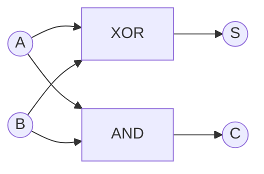
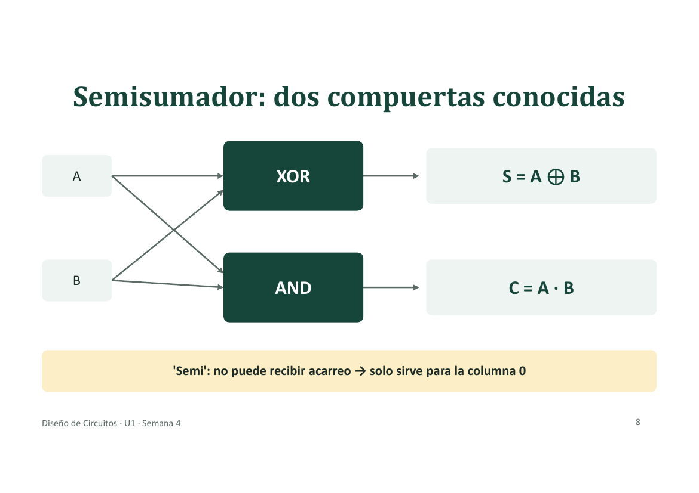
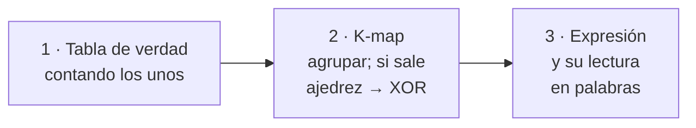
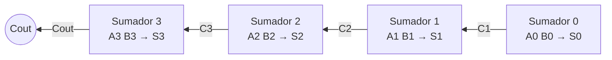
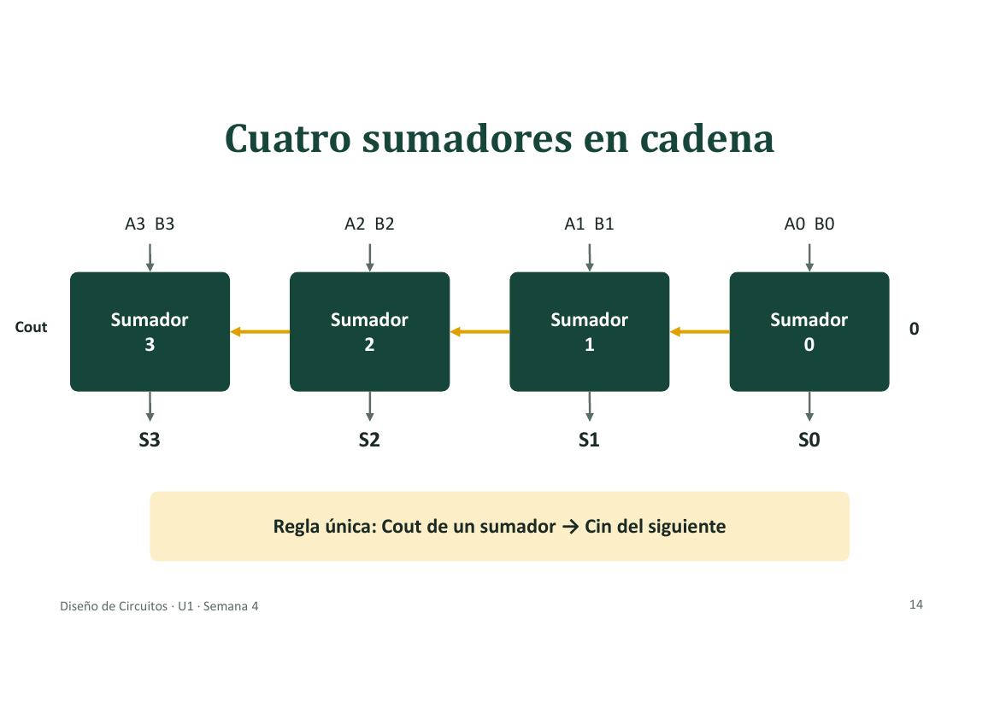
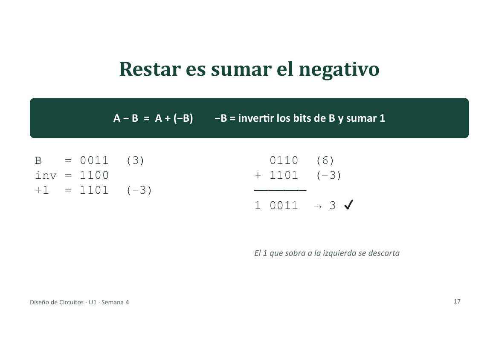
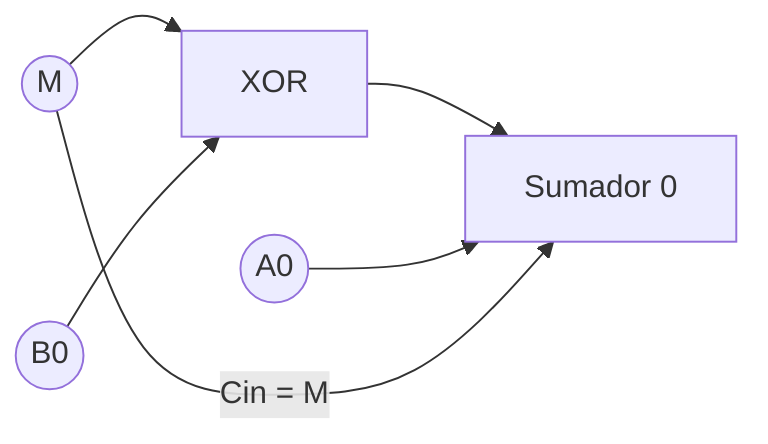
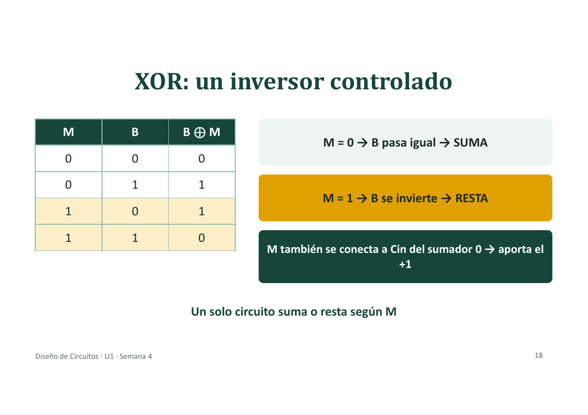
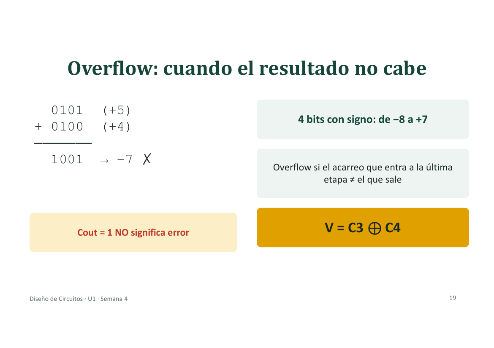
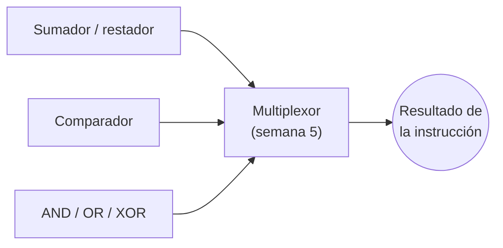

# Semana 4 · Circuitos aritméticos: ¿cómo suma un circuito?

> **Diseño de Circuitos · Unidad 1: lógica combinacional con diseño clásico** · Ing. Luis Darío Sinche Cueva, Mg.
> Temas: semisumador, sumador completo, sumador de 4 bits, resta, overflow y comparador.

[⬅️ Semana 3 · S2](semana-03-sesion-2-indiferentes-nand-nor.md) · [Índice](../README.md)

---

## 🎯 Objetivo de la sesión

Diseñar, con el procedimiento clásico, un circuito que **suma números binarios de 4 bits**, usarlo también para **restar** y **estimar cuánto tarda** en dar el resultado.

- Aporta al resultado **R1**: diseña circuitos combinacionales básicos.
- Es el corazón de la **ALU** de un procesador.
- Prepara la **APE 04** (laboratorio).

---

## 1. Sumar un solo bit: solo 4 casos

| Operación | Resultado | Escribo (**S**) | Me llevo (**C**) |
|:-:|:-:|:-:|:-:|
| 0 + 0 | 0 | 0 | 0 |
| 0 + 1 | 1 | 1 | 0 |
| 1 + 0 | 1 | 1 | 0 |
| 1 + 1 | 2 = 10₂ | 0 | 1 |

- **S** = Suma: el dígito que se escribe.
- **C** = *Carry* (acarreo): el que «me llevo».

Igual que en decimal: `7 + 5 = 12` → escribo 2, llevo 1.

---

## 2. Ejemplo: `0110 + 0111`, columna por columna

```text
acarreo   1 1 0 0
          0 1 1 0   ( 6)
        + 0 1 1 1   ( 7)
        ---------
          1 1 0 1   (13)
```

| Columna | Suma | Escribo | Llevo |
|:-:|:-:|:-:|:-:|
| 0 | 0 + 1 = 1 | 1 | 0 |
| 1 | 1 + 1 = 2 | 0 | 1 |
| 2 | 1 + 1 + 1 = 3 | 1 | 1 |
| 3 | 0 + 0 + 1 = 1 | 1 | 0 |

### El acarreo puede aparecer en cualquier lado

```text
acarreo   1 1 1 0
          0 1 1 1   (7)
        + 0 0 0 1   (1)
        ---------
          1 0 0 0   (8)
```

Un acarreo provoca otro: **se encadenan**.

---

## 3. Dos tipos de columna, dos circuitos

| Columna | Suma… | Circuito |
|---|---|---|
| **Columna 0** | 2 bits: A y B (a su derecha no hay nada) | **Semisumador** |
| **Columnas 1, 2, 3…** | 3 bits: A, B y el acarreo que llega (`Cin`) | **Sumador completo** |

---

## 4. Semisumador

| A | B | C | S |
|:-:|:-:|:-:|:-:|
| 0 | 0 | 0 | 0 |
| 0 | 1 | 0 | 1 |
| 1 | 0 | 0 | 1 |
| 1 | 1 | 1 | 0 |

- Columna **S**: vale 1 cuando A y B son **distintos** → es una **XOR**.
- Columna **C**: vale 1 solo cuando A y B son **ambos 1** → es una **AND**.

```text
S = A ⊕ B
C = A · B
```



> **«Semi»:** no puede recibir acarreo, por eso solo sirve para la columna 0.



---

## 5. Sumador completo: el truco de contar unos

Se **cuentan los unos** de la fila y se escribe ese número **en binario**: los dos dígitos son `Cout S`.

| A | B | Cin | # de 1 | Binario | **Cout** | **S** |
|:-:|:-:|:-:|:-:|:-:|:-:|:-:|
| 0 | 0 | 0 | 0 | 00 | 0 | 0 |
| 0 | 0 | 1 | 1 | 01 | 0 | 1 |
| 0 | 1 | 0 | 1 | 01 | 0 | 1 |
| 0 | 1 | 1 | 2 | 10 | 1 | 0 |
| 1 | 0 | 0 | 1 | 01 | 0 | 1 |
| 1 | 0 | 1 | 2 | 10 | 1 | 0 |
| 1 | 1 | 0 | 2 | 10 | 1 | 0 |
| 1 | 1 | 1 | 3 | 11 | 1 | 1 |

### En palabras

- **S = 1** cuando hay un número **impar** de unos (1 o 3).
- **Cout = 1** cuando hay **al menos dos** unos (la mayoría).

### K-map de S: el «tablero de ajedrez»

| A \ B·Cin | 00 | 01 | 11 | 10 |
|:-:|:-:|:-:|:-:|:-:|
| **0** | 0 | **1** | 0 | **1** |
| **1** | **1** | 0 | **1** | 0 |

Los unos están alternados: **ningún 1 tiene vecino**, no hay grupos posibles. Cuando sale un ajedrez, la función es una XOR:

```text
S = A ⊕ B ⊕ Cin
```

### K-map de Cout: tres grupos de dos

| A \ B·Cin | 00 | 01 | 11 | 10 |
|:-:|:-:|:-:|:-:|:-:|
| **0** | 0 | 0 | **1** | 0 |
| **1** | 0 | **1** | **1** | **1** |

| Grupo | Término |
|---|:---:|
| Columna 11 | `B·Cin` |
| Fila A = 1, columnas 11 y 10 | `A·B` |
| Fila A = 1, columnas 01 y 11 | `A·Cin` |

```text
Cout = AB + A·Cin + B·Cin        (al menos dos unos)
```

### ¿Hay que memorizar las fórmulas? **No.**



Lo que sí se recuerda: **S = impar de unos · Cout = al menos dos unos.**

---

## 6. Cuatro sumadores en cadena

Regla única: **el `Cout` de un sumador entra al `Cin` del siguiente.**





### «Ripple»: el acarreo avanza como una ola

Cada sumador **espera el acarreo del anterior**, así que el resultado se completa de derecha a izquierda: el sumador 0 queda listo en t1, el 1 en t2, el 2 en t3 y el 3 en t4.

### Por eso tarda: estimación del retardo

- Cada compuerta tarda ≈ **10 ns**.
- El acarreo cruza ≈ **2 compuertas por etapa**.

```text
Retardo ≈ 2 · n · 10 ns
```

| Bits | Compuertas | Tiempo aprox. |
|:-:|:-:|:-:|
| 4 | 8 | **80 ns** |
| 16 | 32 | **320 ns** |
| 32 | 64 | **640 ns** |

**Más bits → más lento.**

---

## 7. Restar es sumar el negativo

```text
A − B = A + (−B)        y        −B = invertir los bits de B y sumar 1
```

Ejemplo `6 − 3`:

```text
B   = 0011  (3)
inv = 1100
+1  = 1101  (−3)

  0110  (6)
+ 1101  (−3)
-------
1 0011  → 0011 = 3 ✓     (el 1 que sobra a la izquierda se descarta)
```



### XOR: un inversor controlado

| M | B | B ⊕ M |
|:-:|:-:|:-:|
| 0 | 0 | 0 |
| 0 | 1 | 1 |
| 1 | 0 | 1 |
| 1 | 1 | 0 |

- **M = 0** → B pasa igual → **SUMA**.
- **M = 1** → B se invierte → **RESTA**.
- M también se conecta al `Cin` del sumador 0, así aporta el **+1** del complemento a dos.

**Un solo circuito suma o resta según M.**





---

## 8. Overflow: cuando el resultado no cabe

```text
  0101  (+5)
+ 0100  (+4)
-------
  1001  → −7 ✗
```

Con 4 bits y signo el rango es **de −8 a +7**; el 9 no cabe y el resultado sale con signo equivocado.

**Cómo se detecta:** hay overflow si el acarreo que **entra** a la última etapa es distinto del que **sale**.

```text
V = C3 ⊕ C4
```

> ⚠️ **`Cout = 1` NO significa error.** Por ejemplo, en `6 − 3` sobra un 1 a la izquierda y el resultado es correcto.



---

## 9. Comparador de magnitud

| Pregunta | Cómo se resuelve |
|---|---|
| **¿A = B?** | Una **XNOR** en cada bit (vale 1 si son iguales) y una **AND** de todas |
| **¿A > B?** | Se mira **desde la izquierda**: el primer bit en que difieren decide |

Para 2 bits: `A > B` si A gana en el bit alto, **o** empatan ahí y A gana en el bajo. El integrado comercial es el **7485**.

---

## 10. De aquí sale la ALU



---

## 11. Demostración: `0101 + 0011` en el circuito

| Etapa | A | B | Cin | # de 1 | S | Cout |
|:-:|:-:|:-:|:-:|:-:|:-:|:-:|
| 0 | 1 | 1 | 0 | 2 | 0 | 1 |
| 1 | 0 | 1 | 1 | 2 | 0 | 1 |
| 2 | 1 | 0 | 1 | 2 | 0 | 1 |
| 3 | 0 | 0 | 1 | 1 | 1 | 0 |

**Resultado: `1000` = 8.**

- Sin signo: **correcto** (5 + 3 = 8).
- Con signo: **overflow**, porque `C3 = 1` y `C4 = 0` → `V = 1`.

---

## 📝 Resumen

| Concepto | Idea clave |
|---|---|
| **S y C** | S se escribe · C «me llevo» |
| **Semisumador** | `S = XOR` · `C = AND` · solo sirve para la columna 0 |
| **Sumador completo** | S = impar de unos · Cout = al menos dos unos |
| **Ripple** | El acarreo avanza etapa por etapa |
| **Resta** | M = 1: la XOR invierte B y `Cin = 1` |
| **Overflow** | `V = C3 ⊕ C4`, no `Cout` |

---

[⬅️ Semana 3 · S2](semana-03-sesion-2-indiferentes-nand-nor.md) · [Índice](../README.md)
